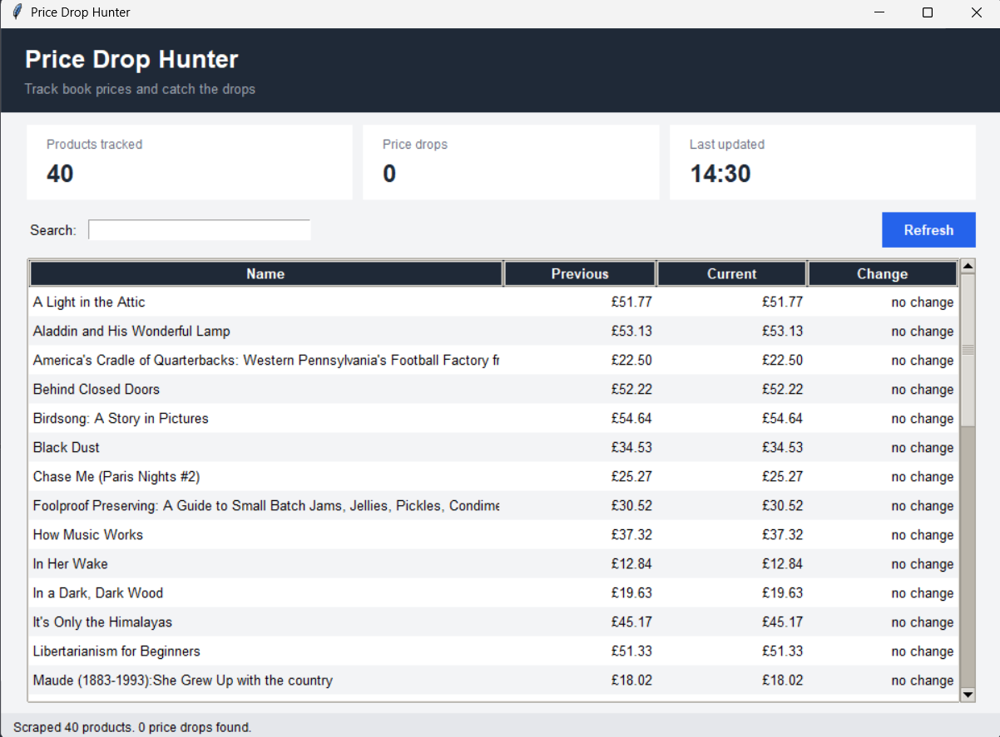
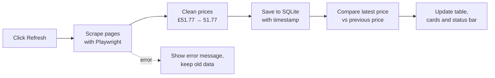
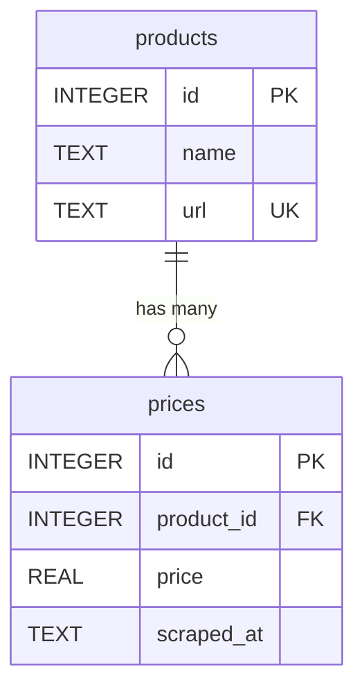

<div align="center">

# 📉 Price Drop Hunter

**A desktop app that scrapes product prices, remembers their history, and tells you when something gets cheaper.**


<br>



</div>

---

## 📖 Table of Contents

1. [The problem](#-the-problem)
2. [What it does](#-what-it-does)
3. [Tech stack](#-tech-stack)
4. [How it works](#-how-it-works)
5. [Database design](#-database-design)
6. [Code walkthrough](#-code-walkthrough)
7. [Python concepts used](#-python-concepts-used-and-where)
8. [Design decisions](#-design-decisions-and-why)
9. [Error handling and testing](#-error-handling-and-testing)
10. [Bugs I hit and fixed](#-bugs-i-hit-and-fixed)
11. [How to run](#-how-to-run)
12. [Project structure](#-project-structure)
13. [Limitations and future work](#-limitations-and-future-work)
14. [About me](#-about-me)

---

## 🎯 The problem

Online prices change often, and checking them by hand every day is slow and easy to forget. Nobody keeps a record of how a price moved, so you can't tell whether a "discount" is real.

**Price Drop Hunter** solves this by saving every price it sees with a timestamp, then comparing the newest price with the previous one.

The full written problem statement is in [`docs/problem_statement.txt`](./problem_statement.txt).

---

## ✨ What it does

| Feature | Details |
|---|---|
| 🕷️ **Scrapes** | Collects the title, price, and link of every book across multiple pages (default: 2 pages, 40 books) |
| 💾 **Remembers** | Saves every scrape with a timestamp, so price history builds up over time |
| 📉 **Detects drops** | Compares the latest price with the previous one for every product |
| 🖥️ **Shows it clearly** | Desktop window with summary cards, a sortable-by-drop table, and green highlighting for price drops |
| 🔍 **Search** | Filters the table as you type |
| 🛡️ **Fails safely** | If the site is unreachable, you see an error message and your saved data stays on screen |

---

## 🧰 Tech stack

| Tool | Used for |
|---|---|
| **Python 3** | The whole application, in one file |
| **Playwright** | Opening the website in a headless browser and reading the page |
| **SQLite (`sqlite3`)** | Storing products and price history in `prices.db` |
| **Tkinter / `ttk`** | The desktop interface |
| **`datetime`** | Timestamping each scrape |
| **`random` + `time`** | A polite random delay between page loads |
| **`urllib.parse`** | Turning relative links into full URLs |

**Target site:** [books.toscrape.com](https://books.toscrape.com), a practice website built for scraping. I chose it on purpose: big shops block bots and change their HTML often, so a scraper built on them breaks easily. A stable target lets the database and GUI logic be tested reliably.

---

## ⚙️ How it works



1. **Refresh** is clicked and the button locks itself so it can't be double-clicked.
2. The **scraper** opens the site, reads every book card on the page, clicks "next", and repeats.
3. Each price text like `£51.77` is **cleaned** into the number `51.77`.
4. The results are **saved**: new books go into `products`, and *every* scrape adds a new row to `prices`.
5. The **price logic** looks at the latest two prices per product and calculates the change.
6. The **GUI** redraws the table, with drops sorted to the top and highlighted green.

---

## 🗄️ Database design

Two tables. Prices live in their own table, because one product has **many** prices over time. That separation is what makes "history" possible.



```sql
CREATE TABLE IF NOT EXISTS products(
    id   INTEGER PRIMARY KEY AUTOINCREMENT,
    name TEXT NOT NULL,
    url  TEXT NOT NULL UNIQUE          -- stops duplicate books
);

CREATE TABLE IF NOT EXISTS prices(
    id         INTEGER PRIMARY KEY AUTOINCREMENT,
    product_id INTEGER NOT NULL,
    price      REAL NOT NULL,
    scraped_at TEXT NOT NULL,
    FOREIGN KEY (product_id) REFERENCES products(id)
);
```

**Why `UNIQUE` on `url`?** The URL identifies a book. With `INSERT OR IGNORE`, scraping the same book twice never creates a duplicate product. It only adds a new price row.

---

## 🔬 Code walkthrough

The whole app is **one file**, split into six labelled sections so it's easy to navigate.

```
# ---------- 1. IMPORTS & SETTINGS ----------
# ---------- 2. DATABASE FUNCTIONS ----------
# ---------- 3. SCRAPING FUNCTIONS ----------
# ---------- 4. PRICE LOGIC ----------
# ---------- 5. GUI ----------
# ---------- 6. RUN THE APP ----------
```

### 1. Settings
Values that might change (the URL, how many pages, the database name) are constants at the top, so nothing is hardcoded deep inside functions.

```python
BASE_URL = "https://books.toscrape.com"
PAGES_TO_SCRAPE = 2
DB_NAME = "prices.db"
```

### 2. Database functions

**`create_tables()`** runs on startup. `CREATE TABLE IF NOT EXISTS` makes it safe to run every time.

**`save_products(products)`** saves one scrape. For each product it does three steps:

```python
# 1. add the product only if its URL is new
cur.execute("INSERT OR IGNORE INTO products (name, url) VALUES (?, ?)", (item["name"], item["url"]))
# 2. find its id
cur.execute("SELECT id FROM products WHERE url = ?", (item["url"],))
p_id = cur.fetchone()[0]
# 3. ALWAYS add a new price row
cur.execute("INSERT INTO prices (product_id, price, scraped_at) VALUES (?, ?, ?)", (p_id, item["price"], now))
```

- `now` is created **once before the loop**, so all 40 rows from one scrape share the same timestamp.
- All queries use `?` placeholders, **never f-strings**, so a title containing quotes or SQL characters cannot break or attack the database.
- The function uses `try / except / finally`: on any error it **rolls back** the half-saved scrape and **always closes** the connection (see [Bugs I hit](#-bugs-i-hit-and-fixed)).

### 3. Scraping functions

**`clean_price(text)`** keeps only digits and the dot, then converts to a number. It also copes with the garbled `£` that bad text encoding can produce.

```python
def clean_price(price_text):
    price = "".join(ch for ch in price_text if ch.isdigit() or ch == '.')
    return float(price)
```

**`scrape_books(pages)`** uses Playwright's locators:

| Playwright call | Used for |
|---|---|
| `page.locator("article.product_pod")` | Finding all book cards on the page |
| `.count()` and `.nth(i)` | Looping over the cards |
| `.get_attribute("title")` | Getting the **full** title (the visible text is cut off with "...") |
| `.inner_text()` | Reading the price text |
| `urljoin(page.url, href)` | Building a correct full URL |
| `page.locator(".next a")` + `.click()` | Moving to the next page |
| `wait_for_load_state(...)` + `time.sleep(random.uniform(1, 2))` | Waiting for the page, then pausing politely |

**The order inside the loop matters:** scrape the *current* page first, then click "next". (My first version clicked next before scraping, which skipped page 1.)

**Why `urljoin`?** The site's links differ by page. On page 1 they look like `catalogue/book/index.html`, and on page 2 they are just `book/index.html`. `urljoin` handles both correctly, whereas adding a fixed prefix by hand breaks on one of them.

The function **returns a list of dictionaries**, which separates scraping from storing:

```python
{"name": "A Light in the Attic", "price": 51.77, "url": "https://books.toscrape.com/catalogue/..."}
```

### 4. Price logic

**`get_price_changes()`** gets the latest two prices for every product:

```sql
SELECT price FROM prices WHERE product_id = ? ORDER BY id DESC LIMIT 2
```

- First row → **current** price. Second row → **previous** price.
- If there is only one row (first ever scrape), `previous` and `change` are `None`, meaning "nothing to compare yet".
- `change = round(current - previous, 2)`. The `2` matters: without it `round()` produces whole numbers and a £0.40 drop would be rounded to 0 and lost. Rounding also avoids float noise like `4.7600000001`.

**`find_drops(changes)`** is a list comprehension:

```python
def find_drops(changes):
    return [c for c in changes if c["change"] is not None and c["change"] < 0]
```
The `is not None` check comes first, because comparing `None < 0` would crash.

**`refresh_data()`** runs the whole pipeline inside `try/except`, so any failure becomes a status message instead of a crash:

```python
def refresh_data():
    try:
        products = scrape_books()
        if not products:
            raise Exception("No products found - the site layout may have changed")
        save_products(products)
        changes = get_price_changes()
        drops = find_drops(changes)
        return changes, f"Scraped {len(products)} products. {len(drops)} price drops found."
    except Exception as e:
        first_line = str(e).splitlines()[0] if str(e) else type(e).__name__
        return get_price_changes(), f"Error: {first_line}"
```
On error it still returns the saved data from the database, so the table never goes blank.

### 5. GUI

| Part | How it's built |
|---|---|
| Header banner | `tk.Frame` with two `tk.Label`s |
| Summary cards | A helper function `make_card(title)` creates three identical cards (products, drops, last updated) |
| Search box | `tk.Entry` linked to a `StringVar`; `trace_add("write", ...)` redraws the table on every keystroke |
| Table | `ttk.Treeview` with a `ttk.Scrollbar` |
| Row colours | `tag_configure` for `even`/`odd` stripes, `drop` (green) and `rise` (red) |
| Status bar | A `tk.Label` packed at the bottom *before* the table, so it never gets squeezed out |

**`fill_table()`** filters by the search text, sorts so the biggest drops come first, and tags each row:

```python
shown = [c for c in changes if search_text.lower() in c["name"].lower()]
shown.sort(key=lambda c: (c["change"] or 0, c["name"]))
```
`None or 0` gives `0`, so products with no history yet sort neatly in the middle.

**Display helpers** keep formatting out of the logic. `format_price(51.77)` → `£51.77`, and `format_change(-4.77)` → `▼ £4.77`.

**State handling:** `redraw()` and `on_refresh()` are *nested functions* inside `build_gui()`, so they can use the widgets directly. A small dictionary `data = {"changes": []}` holds the current results, because a dictionary's contents can be changed from inside a nested function.

**Refresh button behaviour:** it disables itself and shows "Scraping..." while working, calls `root.update()` so the message appears before the window freezes, then re-enables itself.

### 6. Entry point

```python
def main():
    create_tables()
    build_gui()

if __name__ == '__main__':
    main()
```

---

## 🐍 Python concepts used (and where)

| Concept | Where it appears |
|---|---|
| Functions, docstrings, return values | Every function; the scraper returns a list of dicts |
| Constants | `BASE_URL`, `PAGES_TO_SCRAPE`, `DB_NAME`, colour constants |
| Default arguments | `scrape_books(pages=PAGES_TO_SCRAPE)`, `fill_table(..., search_text="")` |
| Lists and dictionaries | Each product is a dict; results are lists of dicts |
| List comprehension | `find_drops`, the search filter in `fill_table` |
| Generator expression | The digit filter inside `clean_price` |
| `lambda` | Sort key, button command, search trace |
| `enumerate` | Striping alternate table rows |
| Tuple unpacking | `for product_id, name in all_products` |
| `None` handling | `previous` / `change` on the first run, `is None` checks |
| Conditional expressions | `"-" if value is None else f"£{value:.2f}"` |
| f-strings with formatting | `f"£{value:.2f}"` |
| String methods | `join`, `isdigit`, `lower`, `splitlines`, `startswith`, `strftime` |
| `try / except / finally`, `raise` | `refresh_data`, `save_products` |
| Nested functions (closures) | `redraw`, `on_refresh`, `make_card` inside `build_gui` |
| `sqlite3` | Parameterised queries, `INSERT OR IGNORE`, `UNIQUE`, foreign key, `ORDER BY ... LIMIT`, commit, rollback |
| `datetime` | Timestamp each scrape and the "Last updated" card |
| `random` + `time` | Polite delay between pages |
| Web scraping | Playwright locators, attributes, pagination |
| GUI programming | Frames, labels, entries, buttons, `ttk.Treeview`, styles, tags, event tracing |
| `if __name__ == '__main__'` | So the file can be imported without starting the app |

---

## 🧠 Design decisions and why

| Decision | Reason |
|---|---|
| **Scraper returns data instead of printing it** | The database code can use it, and each part can be tested separately |
| **Built inside-out: scraper → database → logic → GUI** | Every step could be tested in the terminal before a window existed, so bugs were easy to locate |
| **Prices in a separate table** | One product has many prices over time; this is what enables history |
| **`UNIQUE` URL + `INSERT OR IGNORE`** | Re-scraping never creates duplicate products |
| **Compare only the *latest two* prices** | "Did it get cheaper since last time?" is the question the app answers |
| **`?` placeholders in SQL** | Protects against SQL injection and quote characters in titles |
| **Headless browser** | No browser window pops up on every Refresh |
| **Practice site as the target** | Stable HTML and no bot blocking, so the app works reliably |
| **Single file with labelled sections** | Simple to read and run, and easy to split into modules later |

---

## 🛡️ Error handling and testing

I tested the logic with fake scraped data, a local copy of the site's HTML structure, and edge cases.

| Situation | Behaviour |
|---|---|
| First ever run | Previous and Change show `-`, 0 drops, no crash |
| Run twice, no price changes | Still 40 products (no duplicates), 80 price rows, change = 0 |
| Price falls | Detected as a drop, row turns green |
| Price rises | **Not** counted as a drop, shown in red |
| Tiny drop (£0.40) | Detected, because rounding keeps 2 decimals |
| Three scrapes in a row | Only the latest two are compared |
| Product missing from a later scrape | Handled without crashing |
| New product appears later | Shown with `-` until it has history |
| Titles with quotes or SQL characters | Stored safely |
| Internet off | Error message shown, saved data stays on screen, database unchanged |
| Scraper returns nothing | Raises a clear error instead of silently "succeeding" |
| Error in the middle of saving | Rolled back; the next Refresh works |

**Testing a price drop by hand** (this site's prices never change, so fake one): lower the newest price of the first book, then restart the app.

```python
import sqlite3
c = sqlite3.connect("prices.db")
c.execute("""UPDATE prices SET price = price - 5
             WHERE id = (SELECT MAX(id) FROM prices WHERE product_id = 1)""")
c.commit()
```

---

## 🐞 Bugs I hit and fixed

Real mistakes taught me the most, so here they are.

| Bug | Cause | Fix |
|---|---|---|
| `KeyError: 'price'` waiting to happen | I had typed the dictionary key as `"pice"` | Fixed the typo before the database code relied on it |
| Page 1 was skipped | I clicked "next" *before* scraping the current page | Scrape first, then click next |
| Broken URLs on page 1 | Hardcoded `/catalogue/` prefix; links differ by page | Used `urljoin(page.url, href)` |
| `Incorrect number of bindings` | Passed 2 values for a query with one `?` | Passed exactly one value: `(item["url"],)` |
| `IndexError` on the first run | Read the second price row when none existed | Check `len(prices) > 1` first |
| Small drops disappeared | `round(x)` rounds to whole numbers | `round(x, 2)` |
| `TypeError: float - NoneType` | An old line stayed below my new `if/else` and ran anyway | Deleted the leftover line |
| `database is locked` after a failed save | The connection wasn't closed when an error occurred | `try / except / finally` with rollback and close |
| `Scraped 0 products` looked like success | An empty result wasn't treated as an error | Raise an error if nothing was scraped |

---

## 🚀 How to run

**Requirements:** Python 3.10 or newer (Tkinter is included with the standard Windows and macOS installers).

```bash
# 1. clone the repository
git clone https://github.com/Aastha-0777/PYTHON/tree/main/price-drop-hunter
cd price-drop-hunter

# 2. install the dependency
pip install -r requirements.txt

# 3. download the browser Playwright uses   
playwright install chromium

# 4. run the app
python price_drop_hunter.py
```

Then click **Refresh**. Click it again later (or after faking a price change) to see drops appear.

> **Linux:** if you get a Tkinter error, install it with `sudo apt install python3-tk`.

---

## 📁 Project structure

```
price-drop-hunter/
├── price_drop_hunter.py     # the whole application (6 labelled sections)
├── requirements.txt         # playwright
├── README.md
├── .gitignore               # ignores prices.db and __pycache__/
└── docs/
    ├── problem_statement.txt
    └── screenshot.png
```

`prices.db` is created automatically on the first run.

---

## 🔮 Limitations and future work

**Current limitations**
- Supports one website.
- The window freezes briefly while scraping (the work runs on the main thread).
- Scraping only happens when you click Refresh.

**Ideas for next versions**
- [ ] Run the scraper in a background thread so the window never freezes
- [ ] Price history chart per product (matplotlib)
- [ ] A second scraper for a real shop, reusing the same database and GUI
- [ ] Email or desktop alert when a price drops
- [ ] Scheduled automatic refresh
- [ ] Split the single file into modules (`scraper`, `database`, `gui`)
- [ ] Automated tests with `pytest`

---

## 👩‍💻 About me

I'm **Aastha**, a Computer Engineering diploma student learning to build real programs. This project brings together what I learned across my Python practice: dictionaries, list comprehensions, functions and closures, file and database handling, web scraping, and GUI programming.

📂 More of my work: [github.com/Aastha-0777](https://github.com/Aastha-0777)

---

<div align="center">

*If you found this project useful or interesting, a ⭐ is appreciated!*

</div>
